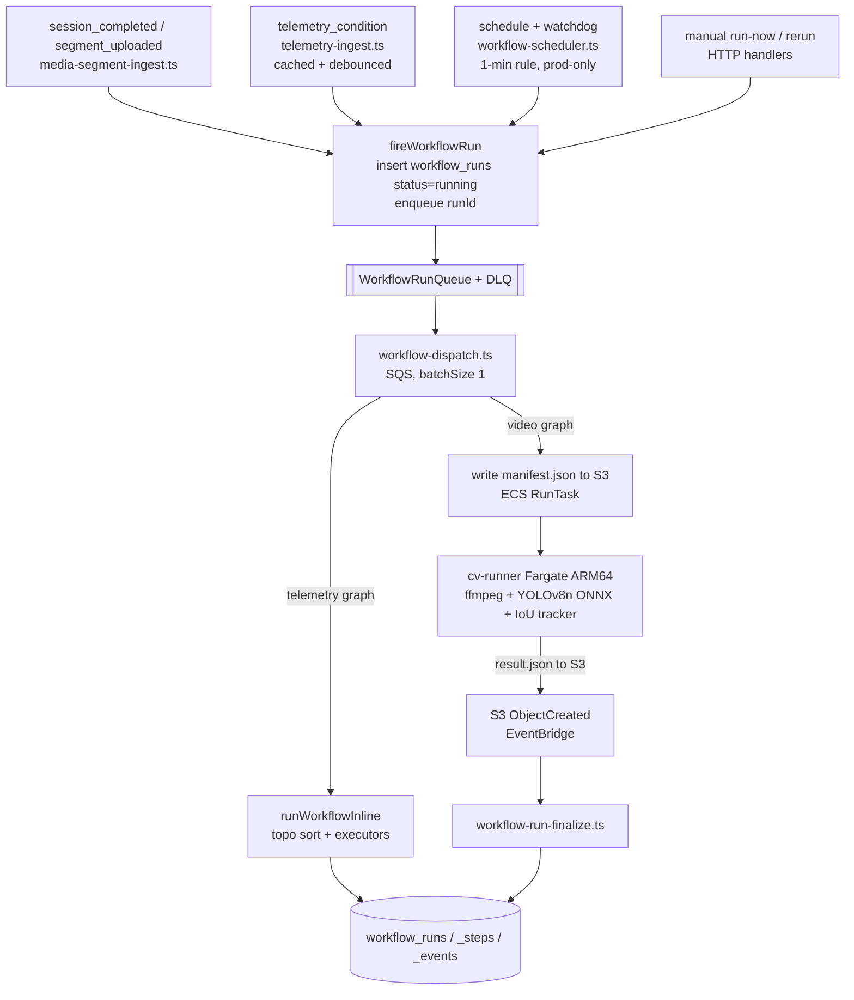

# xorgate-core-service

Xorgate's core backend: an **AWS Lambda + API Gateway (HTTP API v2)** service,
deployed with **AWS CDK**. Each route maps to its own Lambda (native
`APIGatewayProxyEventV2` handlers — no Hono/Express). Data lives in **Aurora
PostgreSQL**, accessed over the **RDS Data API** via **Drizzle ORM**. Auth is
**Cognito** ID tokens; devices get **AWS IoT** X.509 identities and **KVS** WebRTC
channels.

> There is **no API Gateway authorizer** — every route is open at the gateway and
> each handler enforces its own auth (`requireOrgContext`). An "unauthenticated"
> route is simply a handler that doesn't call it (used by the device claim +
> install-script routes below).

## Layout

```
bin/app.ts              # CDK app: wires the stacks (dev imports shared sandbox Aurora; prod builds its own)
lib/stacks/             # storage, database, auth (Cognito), iot, recorder (shared Fargate plane — historic name), api
src/
  handlers/             # one Lambda per file (devices, device-provisioning, device-registrations, install-script, telemetry-*, media-segment-ingest, device-sessions, …)
  services/             # shared logic (iot-provisioning: thing + cert + KVS; media-sessions/media-segments: on-device recording index)
  middleware/auth.ts    # requireAuth / requireOrgContext (Cognito + org/project scoping)
  db/                   # Drizzle schema + RDS Data API client
  assets/install-script.ts  # the install.sh template served per-request
  utils/                # responses, sql casts, registration-code (base32)
drizzle/                # generated migrations (+ manual/ seeds & partitions)
```

## Device lifecycle (registration → telemetry)

The zero-touch onboarding flow added for the
[device agent](../../device/xorgate-device-agent) and
[web app](../../frontend/xorgate-web):

1. **Mint a code** — web app calls `POST /device-registrations` (auth, project-
   scoped). Returns a short-lived (15 min) base32 code + `installUrl`. Idempotent:
   reloading reuses the project's pending code instead of minting a new one. The
   device model is auto-picked (the single seeded model today).
2. **Operator pastes** `curl -s <installUrl> -o install.sh && sudo bash install.sh`
   on the device. `installUrl` is `${API_BASE_URL}/get/<code>`.
3. **Serve the script** — `GET /get/{code}` (unauth) renders
   `assets/install-script.ts` with the code, API base, and dist bucket URL/version
   baked in. Invalid/used/expired codes return a *runnable* bash that exits with a
   clear message.
4. **Claim** — `install.sh` calls `POST /device-registrations/{code}/claim`
   (unauth; the code is the bearer secret). The handler: race-safe flips the code
   `pending→claimed`, creates the `devices` row (serial from the device's
   machine-id, unique per project → `409` on a re-register), then provisions IoT
   via `services/iot-provisioning.ts` (thing + X.509 cert + KVS channels), and
   links the device back. Rolls back (deletes the device + IoT thing, reverts the
   code) on failure. Returns the one-shot cert bundle + `dataEndpoint`.
5. **Poll** — web app polls `GET /device-registrations/{code}` until `claimed`
   (lazy-expires stale codes on read; no sweeper).
6. The device installs the agent under systemd and streams telemetry to
   `xorgate/devices/<deviceId>/telemetry` → IoT rule → `telemetry-ingest` Lambda.

`thingName == device.id == agent DEVICE_ID == MQTT clientId == topic segment` —
the IoT policy (`lib/stacks/iot-stack.ts`) scopes everything to
`${iot:Connection.Thing.ThingName}`, so don't break that chain.

The same `iot-provisioning.ts` service backs the older
`POST /devices/{id}/provision` (provision an already-created device), so both
paths share one code path.

### Dist bucket

Agent build tarballs (`xorgate-agent-<version>.tar.gz`) live in a **public-read**
S3 bucket (`DeviceDistBucket` in `lib/stacks/storage-stack.ts`) — devices download
them during `install.sh` with no AWS creds (the registration code, not S3 auth,
gates access). Published by the device repo's
`.github/workflows/device-deploy-{dev,prod}.yml`. The install Lambda bakes the
bucket URL into the script via `DEVICE_DIST_BUCKET_URL` / `DEVICE_DIST_VERSION`.

## Stream recording (on-device)

KVS WebRTC here is **signaling only**: live media flows peer-to-peer between the
device (master) and the browser, and KVS does not store it. **Recording happens on
the device**, not in the cloud: the agent writes ~60 s MP4 segments locally and
uploads them to `s3://…/media-sessions/v1/…` when it has connectivity, so a drive
through a dead zone still records. The backend only **ingests and indexes** what
the device uploads.

1. **Ingest**: the upload fires an S3 *Object Created* event → **EventBridge** rule
   → `media-segment-ingest` inserts the `media_segments` row (idempotent under
   redelivery) and opens/extends the owning `media_sessions` row.
2. **Close**: a session with no new segments for `MEDIA_SESSION_CLOSE_AFTER_MS` is
   closed — by the `offline-sweeper` schedule, or lazily on read in
   `device-sessions.ts`.
3. **Read**: `GET /devices/{id}/sessions[…]` lists sessions/segments and mints
   presigned playback URLs; `GET /devices/{id}/replay-manifest`
   (`services/replay-manifest.ts`) builds the ordered, gap-aware timeline the
   replay player and the workflow engine both consume.
4. **Trigger**: `segment_uploaded` fires per chunk from `media-segment-ingest`;
   `session_completed` fires once per session on close.

> **Removed 2026-07-28:** a **cloud viewer-recorder** used to exist alongside this —
> a headless KVS viewer on Fargate that joined a device channel as one more viewer,
> remuxed to a single MP4 in `media/v1/*`, and was driven by `POST
> /devices/{id}/recordings` + an auto-record flag. It is gone: handlers, the
> `recordings` table, the `media/v1/*` objects, the ECR repo, and the ECS task
> definition. ⚠️ `lib/stacks/recorder-stack.ts` and the `RECORDER_*` env vars keep
> their historic names but are now the **shared Fargate plane** (VPC, SG, cluster)
> that the workflow engine-runner uses — do not "clean up" those names; renaming the
> cluster would replace it.

## Workflows

User-defined processing pipelines that attach to a device, fire on a trigger, and
produce reviewable runs + events. A **template** is an org-scoped graph of nodes
(catalog type in `node.type`, knobs in `node.data.config`); an **attachment** binds
a *published* template to one device with one or more triggers; a **run** is a
single execution with a step trace and emitted events. Two execution engines sit
behind one SQS queue: **telemetry-only** graphs run **inline** in the dispatcher
Lambda; **video** graphs run on a **Fargate CV task** (Python + ONNX Runtime).



**Schema** (migration `0009`, `db/schema.ts`): `workflow_templates`,
`workflow_template_versions` (app-enforced one-draft + one-published invariant),
`workflow_attachments`, `workflow_trigger_state` (debounce/cooldown + schedule
cursor), `workflow_runs` (snapshot of the definition that ran),
`workflow_run_steps`, `workflow_events`.

**Handlers / services:**

| File | Role |
|---|---|
| `handlers/workflow-templates.ts` | template CRUD + versioning (save draft / publish / restore) in transactions |
| `handlers/device-workflows.ts` | attach / list / enable / detach + Run-now; capability compat check |
| `handlers/workflow-runs.ts` | run list / detail + rerun |
| `handlers/workflow-dispatch.ts` | SQS consumer → inline runner or Fargate launch (idempotent under redelivery) |
| `handlers/workflow-run-finalize.ts` | S3 `result.json` → persist steps/events + run status |
| `handlers/workflow-scheduler.ts` | schedule triggers + stuck-run watchdog (1-min rule, `!disableScheduledJobs`) |
| `services/workflow-triggers.ts` | `fireWorkflowRun` + telemetry / session / segment trigger evaluation |
| `services/workflow-runner.ts` | inline executor registry (telemetry graphs) |
| `services/workflow-fargate.ts` | manifest writer + ECS RunTask (video graphs) |
| `services/workflow-capabilities.ts` | required-capabilities vs `device_models.ioCapabilities` |

**CV runner image** — `cv-runner/` is a Python container (Fargate ARM64), built +
pushed out-of-band (`recorder-stack.ts` — historic name, it is now the shared
Fargate plane — holds the ECR repo `xorgate-cv-runner[-dev]` + task def). It needs
`yolov8n.onnx` baked in; full build/push steps are in
[`cv-runner/README.md`](cv-runner/README.md). Needs ECR/ECS/`iam:PassRole` grants
beyond the base deploy user's (plus `ecr:BatchGetImage`).

**Notes:** new deps `@aws-sdk/client-sqs` + `cron-parser`; the run-firing Lambdas
bundle the AWS SDK (`bundling: bundlingWithSdk`) since client-sqs isn't guaranteed
in the runtime. The scheduler/watchdog rule is **off in dev by default** (Aurora
auto-pause) — enable with `--context scheduledJobs=on`. Apply migration `0009`
before deploying the new Lambdas.

## Routes (summary)

| Route | Auth | Notes |
|-------|------|-------|
| `POST /device-registrations` | yes | mint/reuse a code (project-scoped) |
| `GET /device-registrations/{code}` | yes | poll status (lazy-expire) |
| `POST /device-registrations/{code}/claim` | **no** | called by install.sh — creates + provisions the device |
| `GET /get/{code}` | **no** | renders install.sh (text/x-shellscript) |
| `POST /devices/{id}/provision` | yes | provision an existing device (same IoT service) |
| `GET/POST/PUT/DELETE /devices[/{id}]` | yes | device CRUD (`PUT` also sets `recordingConfig` / `lteRecoveryConfig`) |
| `GET /devices/{id}/{identity,kvs-channels,telemetry,telemetry/latest}` | yes | device detail reads |
| `GET /devices/{id}/sessions[/{sessionId}[/segments…]]` | yes | on-device recordings: list / detail / segments / segment playback URL |
| `GET /devices/{id}/replay-manifest` | yes | ordered segment timeline for the replay player |
| `…/me, /organizations, /projects, /device-models, /api-keys, /iot/attach-policy, /docs` | mixed | platform + tenancy |

`API_BASE_URL` (used to build `installUrl` and the claim URL inside the script) is
injected post-hoc onto the registration Lambdas from `this.api.apiEndpoint` — the
same chicken-and-egg trick as `DOCS_BASE_URL`. No custom DNS yet; it's the
generated `execute-api` endpoint.

## Develop / deploy

```sh
npm run typecheck            # tsc (cdk + lambda projects)
npm run synth:dev            # cdk synth (bundles every Lambda via esbuild)
npm run deploy:dev           # cdk deploy --context stage=dev --all
npm run deploy:prod          # cdk deploy --context stage=prod --all
npm run db:generate          # generate a Drizzle migration after editing src/db/schema.ts
```

The Fargate paths (push a runner image, run/stop tasks) need ECR + ECS +
`iam:PassRole` permissions the base deploy user does not have; grant them separately.

**Migrations** are generated here but **applied out-of-band via the RDS Data
API** — the local deploy credentials lack migration permissions. Status columns
are plain `text` (not `pgEnum`) on purpose: the aws-data-api driver binds enum
values as text and Postgres rejects the implicit cast (see the comments in
`db/schema.ts`).

Dev imports the shared sandbox Aurora cluster + has no VPC; prod builds its own
VPC + cluster. Stage is required: `--context stage=dev|prod`.
